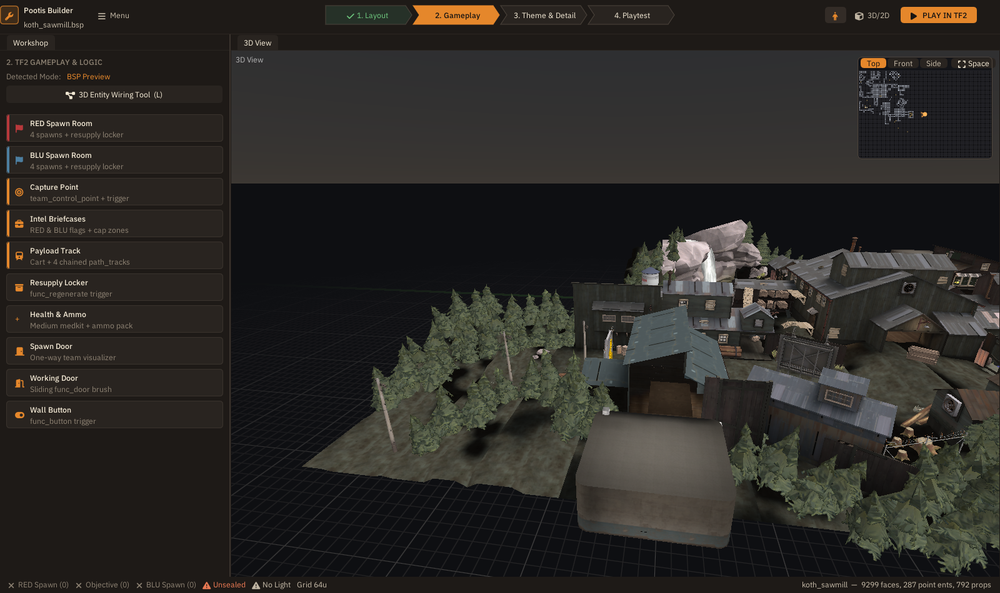
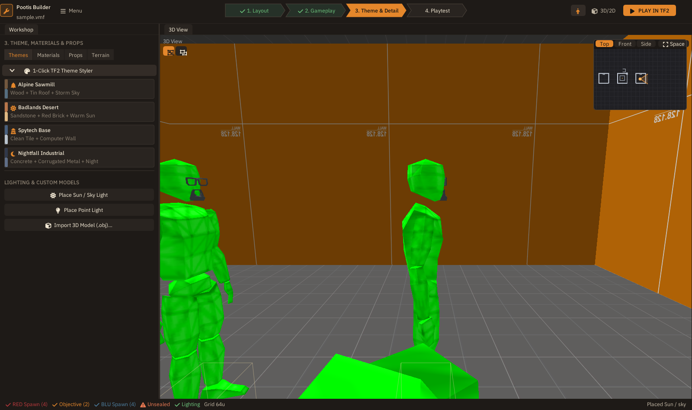

# Pootis Builder

**A modern, native C++20 / OpenGL 3.3 map editor for Team Fortress 2** — designed to be effortless to pick up, yet powerful enough to build, edit, pack, compile, and launch real TF2 maps without opening Hammer.



---

## Highlights

- **4-Stage TF2 Workshop Stepper** — Move cleanly through **1. Layout → 2. Gameplay → 3. Theme & Detail → 4. Playtest** without hunting through 11 docked panels. Jump to any stage at any time with your map, camera, and undo history intact.
- **Direct Push-Pull CAD & Smart Auto-Cut** — Pull any brush face along its normal (`P`) with live snapped dimensions, drop **Doorways** and **Windows** that automatically carve clean portals through existing walls, and toggle a **TF2 83u Scale & Jump Ghost** (`48u` crouch-jump / `72u` double-jump).
- **2D Blueprint PiP & Instant Swap (`Space`)** — Live Top-Down wireframe minimap in the corner of the 3D viewport; press `Space` to flip into full 2D `Top / Front / Side` precision views.
- **Mode-Aware TF2 Gameplay & 3D Entity Wiring** — Auto-detects `CTF`, `KOTH`, `Control Point`, `Payload`, and `Arena` maps. Drag glowing cubic Bezier wires (`L`) directly between entities in 3D space (`OnStartTouch → Open`).
- **1-Click TF2 Theme Styler & Full Asset Browsers** — Restyle greybox rooms in one click (*Alpine Sawmill*, *Badlands Desert*, *Spytech Base*, *Nightfall Industrial*), or browse all 29,000+ TF2 VMT materials, 4,200+ `.mdl` props, and power-2/3/4 displacement terrain tools.
- **Native TF2 Map Import & Compile Pipeline** — Opens editable `.vmf` files losslessly and stock/community `.bsp` maps with **LZMA static-prop decompression** and **embedded BSP Pakfile (Lump 40) mounting**. Compiles via Valve's `vbsp` / `vvis` / `vrad`, auto-packs custom assets with `bspzip`, traces leaks (`.lin`), and launches straight into TF2.



---

## Quick Start (Windows)

### Prerequisites
- **Team Fortress 2** installed via Steam (auto-detected for VPK textures, models, `tf.fgd`, and `vbsp`/`vvis`/`vrad`).
- **MinGW-w64 (GCC), CMake, and Ninja** on `PATH` (or Qt's bundled toolchain under `C:\Qt\Tools`).

### Build & Run
```powershell
powershell -ExecutionPolicy Bypass -File .\build.ps1
.\build\PootisBuilder.exe
```

---

## Key Shortcuts

| Key | Action |
| :--- | :--- |
| `RMB + WASD / Q / E` | Fly camera in 3D view (`Shift` = fast) |
| `V` / `P` / `B` / `C` / `T` / `L` | Select / Push-Pull / Block / Clip / Surface UV / 3D Wire |
| `Space` | Toggle 3D View ↔ 2D Blueprint View |
| `Q` | Radial Pie Menu |
| `G` / `R` / `S` | Modal Move / Rotate / Scale (press `X`/`Y`/`Z` + type value) |
| `Ctrl+K` | Command & Entity Palette |
| `Ctrl+Z` / `Ctrl+Y` | Undo / Redo |
| `Ctrl+B` | Build & Play in TF2 |

---

## Verification & Legacy Archive
- Run headless regression suites (`--pb2-test`, `--undo-test`, `--mx-test`, `--disp-test`, `--leak-test`, `--greybox-test`, `--ai-pool-test`, `--net-test`) or `./test.sh quick`.
- The previous v1 codebase is preserved cleanly in [`archive/v1/`](archive/v1) and tagged `v1-archive`.
